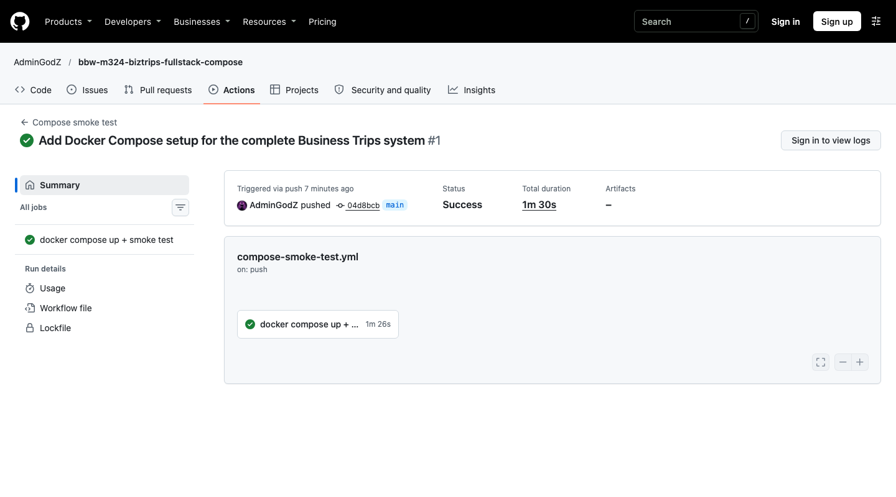

# Business Trips · RefCard05 · Full Stack auf AWS

**Tim Held** · M324 DevOps · BBW · 20.11.2026 · Release **v5.0.2**

Dieses Repo bündelt die lokale Entwicklung (Docker Compose) und dient als Einstieg in die Dokumentation. Frontend und Backend liegen in getrennten Repos, jedes mit eigener Pipeline, eigenem ECR-Repository und eigenem ECS-Service.

| Abgabe | Link |
|---|---|
| Frontend-Repo | <https://github.com/AdminGodZ/bbw-m324-biztrips-fullstack-actions-aws-frontend> · [Doku](https://github.com/AdminGodZ/bbw-m324-biztrips-fullstack-actions-aws-frontend/blob/main/docs/REFCARD05.md) |
| Backend-Repo | <https://github.com/AdminGodZ/bbw-m324-biztrips-fullstack-actions-aws-backend> · [Doku](https://github.com/AdminGodZ/bbw-m324-biztrips-fullstack-actions-aws-backend/blob/main/docs/REFCARD05.md) (Architektur, RDS, S3/IAM, ECS, Secrets/OIDC) |
| Compose-Verzeichnis | dieses Repo |
| Live (solange die Lab-Session läuft) | <http://bbw-m324-refcard05-1247198490.us-east-1.elb.amazonaws.com> |


## Architektur

```mermaid
flowchart LR
  subgraph GitHub
    fe[Frontend-Repo<br/>Pipeline] ; be[Backend-Repo<br/>Pipeline] ; co[Compose-Repo<br/>Submodule v5.0.2]
  end
  fe -->|Image 5.0.2| ecrF[(ECR frontend)]
  be -->|Image 5.0.2| ecrB[(ECR backend)]
  subgraph AWS us-east-1 · Stack bbw-m324-refcard05
    alb[ALB] -->|/| f[ECS Service<br/>biztrips-frontend · nginx]
    alb -->|/v1, /actuator| b[ECS Service<br/>biztrips-backend · Spring Boot]
    b --> rds[(RDS MariaDB 11.8)]
    b --> s3[(S3 Fotos)]
  end
  ecrF --> f
  ecrB --> b
  co -.->|docker compose| local[lokal: nginx + Spring Boot<br/>+ MariaDB 11.8 + S3-Mock]
```

## Lokale Entwicklung: das ganze System starten

Voraussetzungen: Docker (mit Compose v2) und Git. Ein AWS-Zugang ist nicht nötig.

```bash
git clone --recurse-submodules https://github.com/AdminGodZ/bbw-m324-biztrips-fullstack-compose.git
cd bbw-m324-biztrips-fullstack-compose
cp .env.example .env              # optional: Ports und Passwörter für lokal anpassen
docker compose up --build --wait  # oder: make up
./scripts/smoke-test.sh           # oder: make smoke
```

| Dienst | URL | Hinweis |
|---|---|---|
| Frontend | <http://localhost:3000> | nginx leitet `/v1` und `/actuator` an das Backend weiter |
| Backend | <http://localhost:8080/v1/trips> · [Health](http://localhost:8080/actuator/health) | Profil `mariadb`, Foto-Storage `s3` |
| MariaDB | `localhost:3306` | gleiche Major-Version wie RDS (11.8) |
| S3-Mock | intern `http://s3:9090` | S3-kompatibel. Das Backend nutzt lokal denselben S3-Code wie auf AWS. |

**Robust und bequem:**

- **Startreihenfolge über Health-Checks:** `db` und `s3` healthy → `backend` ready (`/actuator/health/readiness` prüft DB und S3) → `frontend`. `--wait` kehrt erst zurück, wenn alles gesund ist.
- **Sinnvolle Defaults:** Ohne `.env` funktioniert alles. Ports sind nur an `127.0.0.1` gebunden. Die Passwörter sind ausdrücklich nur für lokal gedacht und lassen sich über `.env` überschreiben (`.env` ist in `.gitignore`).
- **Daten bleiben erhalten** in den Volumes `db-data` und `s3-data` (`docker compose down`). `docker compose down -v` (`make reset`) setzt alles zurück.
- **Versionen fest gepinnt:** `backend/` und `frontend/` sind Git-Submodule auf dem Release-Tag `v5.0.2`. Aktualisieren: `git -C backend fetch --tags && git -C backend checkout v5.0.3`, danach commiten.
- **CI:** [`compose-smoke-test.yml`](.github/workflows/compose-smoke-test.yml) startet bei jedem Push das ganze System und führt den Smoke-Test aus (Frontend, Readiness, Trips, Mitarbeitende, Foto-Upload und -Download byte-genau).

```text
$ ./scripts/smoke-test.sh
Smoke test against http://localhost:3000
  ✔ frontend /health
  ✔ frontend serves the React app
  ✔ backend ready (db + s3): {"components":{"db":{"status":"UP"},"readinessState":{"status":"UP"},"s3":{"status":"UP"}},"status":"UP"}
  ✔ trips loaded from MariaDB
  ✔ employees loaded
  ✔ photo upload -> S3 (HTTP 200)
  ✔ photo download is byte-identical
All checks passed.
```

**Variante mit den Release-Images aus Amazon ECR** (statt lokal zu bauen):

```bash
eval "$(./scripts/ecr-login.sh | tail -1)"   # braucht gültige Learner-Lab-Credentials
docker compose -f compose.yaml -f compose.ecr.yaml up --wait   # Versionen: BACKEND_VERSION / FRONTEND_VERSION
```

Das Frontend-Image aus ECR enthält die ALB-URL als `VITE_API_BASE_URL`. Compose setzt deshalb `API_BASE_URL=/`, damit dasselbe Image lokal das lokale Backend verwendet.

| Lokal | |
|---|---|
|  |  |

## Scripts

| Script | Zweck |
|---|---|
| [`scripts/smoke-test.sh`](scripts/smoke-test.sh) | End-to-End-Prüfung, auch gegen AWS: `FRONTEND_URL=http://<alb> ./scripts/smoke-test.sh` |
| [`scripts/update-lab-secrets.sh`](scripts/update-lab-secrets.sh) | nach jedem Lab-Start: die 3 Session-Credentials prüfen und als GitHub Secrets in **beiden** Repos setzen |
| [`scripts/ecr-login.sh`](scripts/ecr-login.sh) | Docker-Login für ECR, gibt `ECR_REGISTRY` aus |

## Bewertungsraster → Nachweise

| Kriterium | Umsetzung | Nachweis |
|---|---|---|
| Frontend: CI/CD (build, test, Image → ECR) | lint → Vitest → Vite-Build → nginx-Image → ECR → ECS. npm- und Docker-Layer-Cache, Test-Summary, klare Fehlermeldungen | [Doku FE §1](https://github.com/AdminGodZ/bbw-m324-biztrips-fullstack-actions-aws-frontend/blob/main/docs/REFCARD05.md#1--pipeline-lint--test--build--image--ecr--ecs), [Runs](https://github.com/AdminGodZ/bbw-m324-biztrips-fullstack-actions-aws-frontend/actions) |
| Backend: CI/CD (build, test, Image → ECR) | Maven verify (17 Tests) → Multi-Stage-Image (JDK → JRE) → ECR → ECS. Maven- und Layer-Cache | [Doku BE §1](https://github.com/AdminGodZ/bbw-m324-biztrips-fullstack-actions-aws-backend/blob/main/docs/REFCARD05.md#1--cicd-pipeline-build--test--image--ecr--ecs), [Runs](https://github.com/AdminGodZ/bbw-m324-biztrips-fullstack-actions-aws-backend/actions) |
| Versionierung mit Git-Tags | SemVer `vX.Y.Z` → ECR `X.Y.Z` und `X.Y`. Gemeinsame Release-Linie `v5.0.0`, `v5.0.1`, `v5.0.2` in beiden Repos und hier als Submodule. Version sichtbar in `/actuator/info`, `/version.json`, Footer, OCI-Labels, Task-Definition | [BE §2](https://github.com/AdminGodZ/bbw-m324-biztrips-fullstack-actions-aws-backend/blob/main/docs/REFCARD05.md#2--versionierung-mit-git-tags-semver) |
| RDS über Secrets | DB-Daten nur aus Umgebungsvariablen. User und Passwort aus Secrets Manager, TLS `verify-full`. Profile `default`/`mariadb`/`aws` | [BE §3](https://github.com/AdminGodZ/bbw-m324-biztrips-fullstack-actions-aws-backend/blob/main/docs/REFCARD05.md#3--anbindung-an-rds-mariadb-konfiguration-über-secrets) |
| S3 und IAM Least Privilege | `S3PhotoStorage`, Fehlerfälle → 503/404. Bucket-Policy beschränkt die Task-Rolle auf `employee-photos/*`, eigene Task-Rolle für den produktiven Account im Template. Mit Prüf-Task nachgewiesen | [BE §4](https://github.com/AdminGodZ/bbw-m324-biztrips-fullstack-actions-aws-backend/blob/main/docs/REFCARD05.md#4--bilder-storage-auf-amazon-s3-und-iam-least-privilege) |
| ECS Frontend (nginx) | Fargate 0.25 vCPU/512 MB, Health-Checks Container und ALB, Circuit Breaker | [FE §3](https://github.com/AdminGodZ/bbw-m324-biztrips-fullstack-actions-aws-frontend/blob/main/docs/REFCARD05.md#3--nginx-container-auf-ecs-fargate) |
| ECS Backend | Fargate 0.5 vCPU/1 GB, Readiness (DB und S3), Rolling 100/200, Rollback | [BE §5](https://github.com/AdminGodZ/bbw-m324-biztrips-fullstack-actions-aws-backend/blob/main/docs/REFCARD05.md#5--ecs-deployment-fargate) |
| Automatisches Redeploy | Neues Image → neue Task-Definition-Revision → Rolling Update. Verifikation über den ALB (Version 5× in Folge), Job-Summary | [BE §6](https://github.com/AdminGodZ/bbw-m324-biztrips-fullstack-actions-aws-backend/blob/main/docs/REFCARD05.md#6--automatisches-redeploy-bei-neuem-image-und-überwachung) |
| Learner-Lab-Credentials als Secrets | 3 Secrets pro Repo, keine Credentials im Code. Session-Prüfung mit klarer Meldung, Erneuerungs-Skript, Vergleich mit OIDC | [BE §7](https://github.com/AdminGodZ/bbw-m324-biztrips-fullstack-actions-aws-backend/blob/main/docs/REFCARD05.md#7--learner-lab-zugangsdaten-als-github-secrets) |
| Docker Compose | dieses Repo: Health-Check-Reihenfolge, Defaults, S3-Mock, CI-Smoke-Test | oben |
| Dokumentation | je Repo `docs/REFCARD05.md` mit Screenshots (Commits, Workflows, ECR, ECS, S3, RDS) | Links oben |
| Individuelle Lösung | eigene Commits mit Begründung, PRs mit beschriebenen Änderungen, eigene Releases und Problemlösungen | [BE-Commits](https://github.com/AdminGodZ/bbw-m324-biztrips-fullstack-actions-aws-backend/commits/main), [FE-Commits](https://github.com/AdminGodZ/bbw-m324-biztrips-fullstack-actions-aws-frontend/commits/main), [BE §9 Probleme](https://github.com/AdminGodZ/bbw-m324-biztrips-fullstack-actions-aws-backend/blob/main/docs/REFCARD05.md#9--probleme-und-lösungen) |
